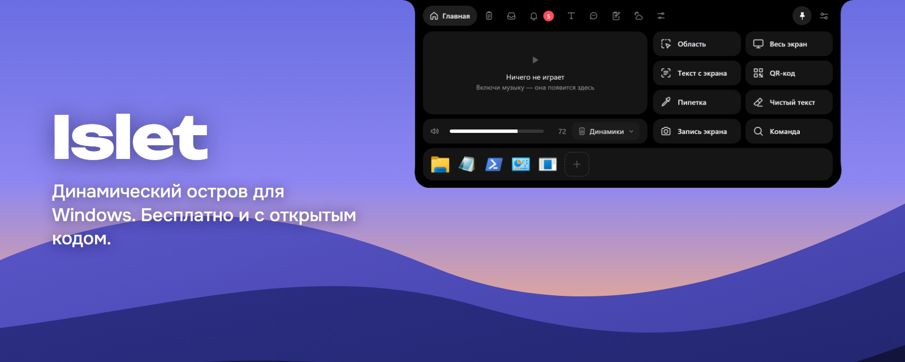
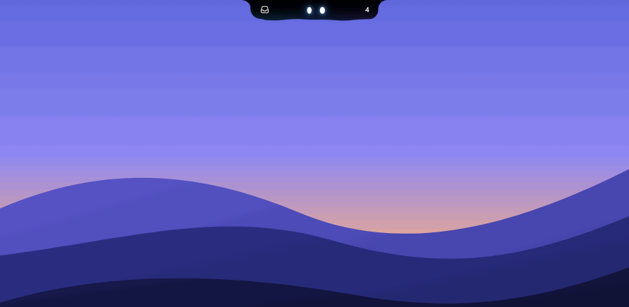
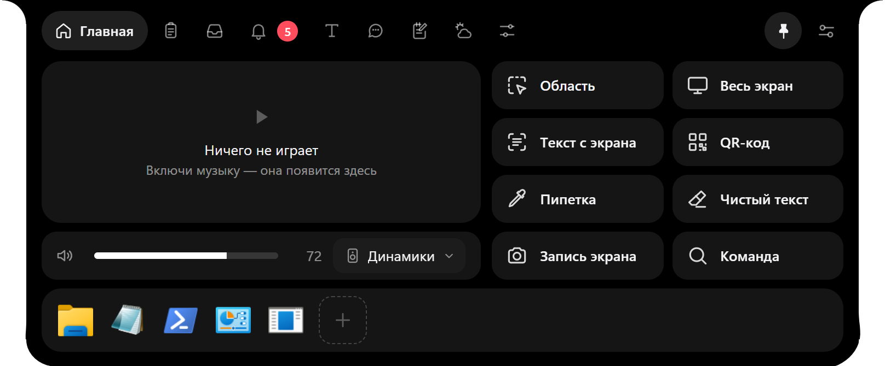
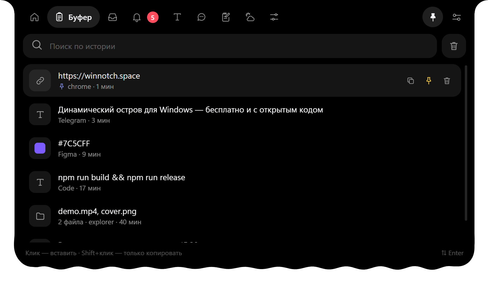
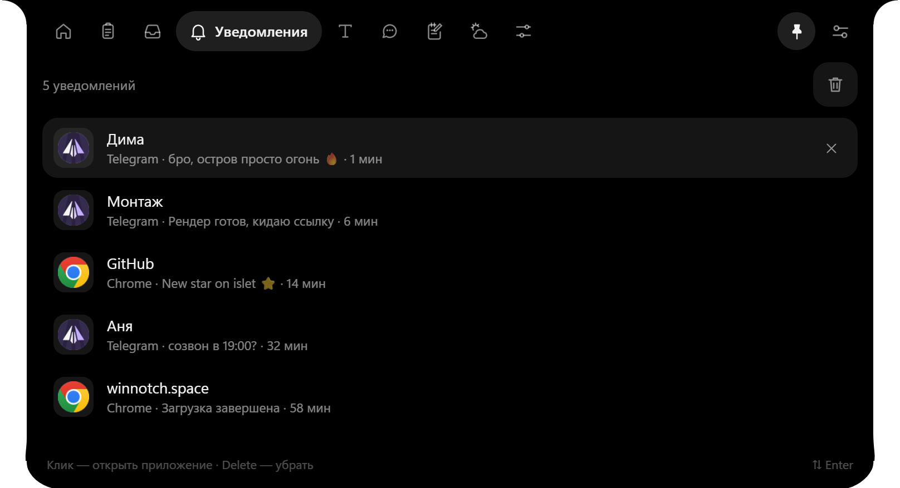
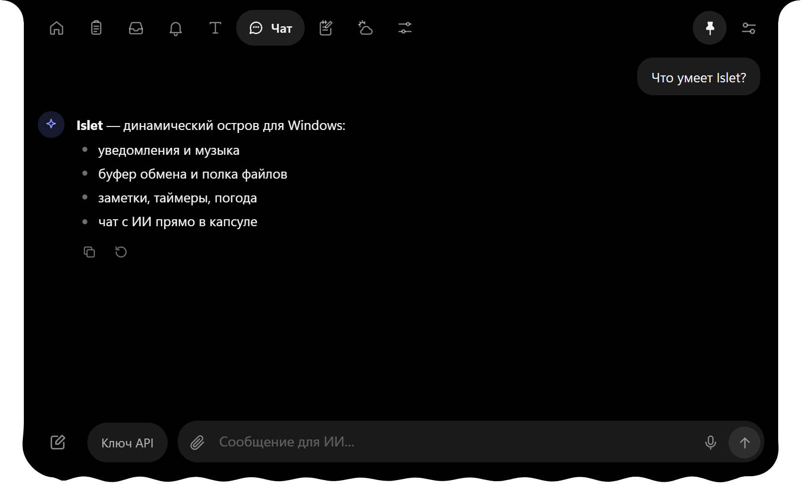
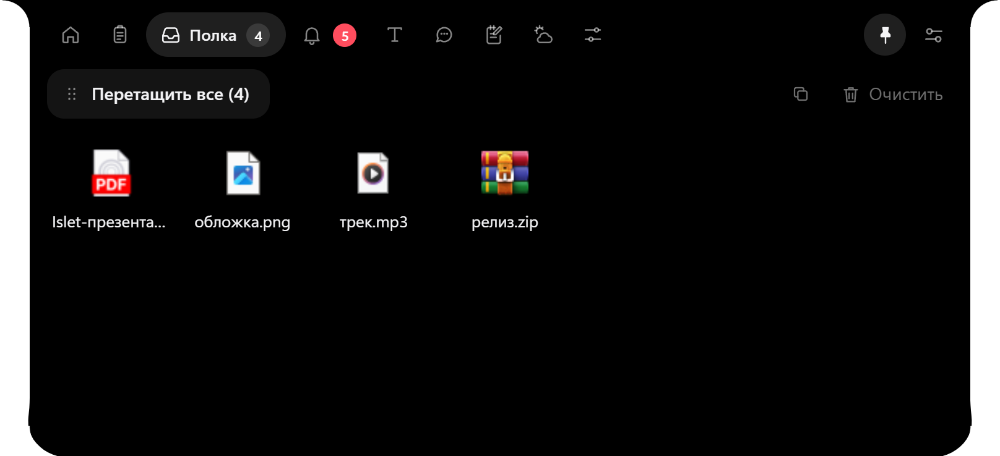
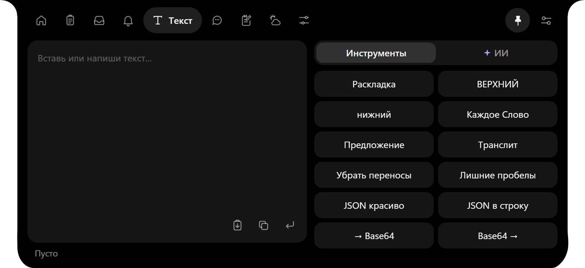

<p align="center"></p>

<p align="center">
  <a href="https://github.com/PlaybackG/islet/releases/latest/download/IsletSetup.exe"></a>
  <a href="https://playbackg.github.io/islet/"></a>
  <a href="https://github.com/PlaybackG/islet/releases/latest"></a>
  <a href="LICENSE"></a>
</p>

Маленькая капсула наверху экрана. Наведи мышку, и в ней музыка, файлы, уведомления и чат с ИИ. Убрал мышку, и она снова не мешает. Для Windows 10 и 11, бесплатно и с открытым кодом.

<p align="center"></p>

## Что умеет

| | |
|---|---|
| **Музыка.** Обложка, управление и волна под бит прямо в капсуле. | **Буфер.** Всё, что ты копировал, с поиском и закреплением. |
|  |  |
| **Уведомления.** Сообщения с иконками приложений, клик открывает приложение. | **Чат с ИИ.** Спросить что-то, не открывая браузер. |
|  |  |
| **Полка.** Перетащи файлы на остров и забери, когда понадобятся. | **Текст.** Раскладка, регистр, транслит, JSON, Base64 и ИИ-правка. |
|  |  |

А ещё заметки с таймерами, погода, управление системой, загрузки с настоящим процентом и глазки: в покое они моргают, следят за курсором и меняют стиль.

## Установка

1. Скачай [IsletSetup.exe](https://github.com/PlaybackG/islet/releases/latest/download/IsletSetup.exe), около 140 МБ.
2. Запусти. Windows может предупредить о неизвестном издателе: нажми «Подробнее», потом «Выполнить в любом случае».
3. Остров появится сверху экрана и будет запускаться вместе с Windows.

## Запуск из исходников

Нужен [Node.js](https://nodejs.org) 20 или новее.

```bash
cd islet
npm install
npx electron .
```

## Что где

- `islet/` — приложение (Electron). `main.js` — основной процесс, `ui/` — интерфейс, `native.js` — вызовы WinAPI, `helper.ps1` — медиа, громкость, OCR.
- `site/` — лендинг на GitHub Pages.
- `videos/islet-tiktok/` — ролик на HyperFrames (аудио в репозиторий не входит).

## Ключи

Ключи для чата с ИИ и распознавания речи вводятся в настройках приложения и хранятся только у тебя в `%APPDATA%\Islet`. В репозитории ключей нет.

## Благодарность

Скоро

## Лицензия

[MIT](LICENSE)
